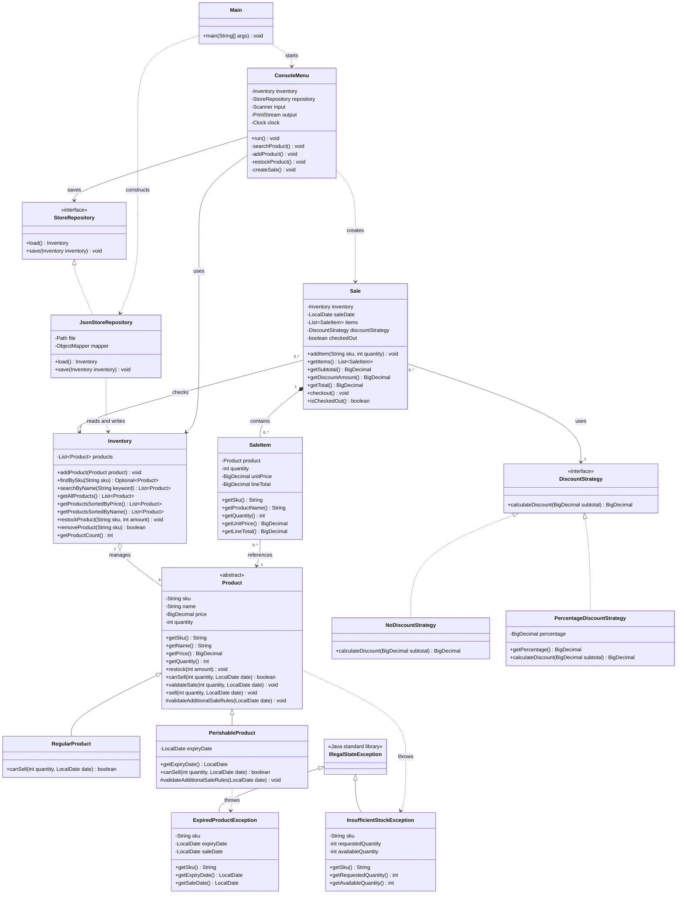

# RetailFlow — UML Class Diagram

This UML class diagram illustrates the main classes, attributes, methods, and relationships within the RetailFlow application. 

It demonstrates inheritance, abstraction, composition, aggregation, associations, and the Strategy and Repository design patterns.

The diagram focuses on the application's production classes and excludes automated test classes and external library implementations.

## Relationships and multiplicities

| Relationship | UML interpretation |
|---|---|
| `Product` ⇢ `RegularProduct` / `PerishableProduct` | Abstract superclass and two concrete subclasses; overridden eligibility rules enable runtime polymorphism. |
| `Inventory` ◇— `Product` | Shared aggregation: one inventory manages **0..\*** product objects. Products are also referenced by sale items. |
| `Sale` ◆— `SaleItem` | Composition: one sale creates and owns **0..\*** line items (an empty sale cannot check out). |
| `SaleItem` → `Product` | Each line item references exactly one product; the same product can appear in different sales. |
| `Sale` → `Inventory` | Each sale uses exactly one inventory for validation and deduction. |
| `Sale` → `DiscountStrategy` | Each sale has exactly one strategy; a strategy implementation can be shared by multiple sales. |
| `NoDiscountStrategy` / `PercentageDiscountStrategy` ⇢ `DiscountStrategy` | Interface realization (Strategy Pattern). |
| `JsonStoreRepository` ⇢ `StoreRepository` | Interface realization (Repository abstraction). |
| `ConsoleMenu` → `Inventory` / `StoreRepository` | Console delegates to existing business and storage objects. |
| `Product` / `PerishableProduct` ⇢ custom exceptions | Dependencies: methods throw specific exceptions on stock or expiry violations. |
| `IllegalStateException` → Custom Exceptions | Inheritance: `InsufficientStockException` and `ExpiredProductException` extend Java's `IllegalStateException`, allowing specific domain errors to remain compatible with general illegal-state exception handling. |

**Notes:** This UML diagram presents the main classes and their relationships rather than every method or external dependency. The relationships represent the application's in-memory object structure. JSON persistence stores inventory data only, not historical sales transactions. A `Sale` may contain zero or more `SaleItem` objects while being constructed, but checkout requires at least one item.
